<p align="center">
  
</p>

<p align="center">
  <strong>Turn raw GitHub repository activity into plain-English stories, live interactive lifecycle pipelines, and community intelligence.</strong>
</p>

<p align="center">
  <a href="https://snehashis365.github.io/GitStory/"></a>
  <a href="#-universal-ai-provider-hub"></a>
</p>

<p align="center">
  <a href="https://react.dev/"></a>
  <a href="https://www.typescriptlang.org/"></a>
  <a href="https://vitejs.dev/"></a>
  <a href="https://tailwindcss.com/"></a>
  <a href="https://motion.dev/"></a>
  <a href="LICENSE"></a>
</p>

---

## 🧭 Navigation

- [🌟 What is GitStory?](#-what-is-gitstory)
- [🚀 Key Superpowers](#-key-superpowers)
  - [1. 🤖 Universal AI Provider Hub](#1--universal-ai-provider-hub)
  - [2. ⚡ Interactive 2D Lifecycle Flow](#2--interactive-2d-lifecycle-flow)
  - [3. 📖 Project 101 & Peek Markdown README](#3--project-101--peek-markdown-readme)
  - [4. 💬 Contextual AI Guide Drawer](#4--contextual-ai-guide-drawer)
  - [5. ⏱️ Smart Adaptive Cadence & Auto-Sync](#5-️-smart-adaptive-cadence--auto-sync)
  - [6. 🛡️ Dual-Tier Caching & Cloudflare Edge Gateway](#6-️-dual-tier-caching--cloudflare-edge-gateway)
- [🛠️ Tech Stack](#️-tech-stack)
- [🏁 Getting Started](#-getting-started)
- [🌐 Deploying to GitHub Pages](#-deploying-to-github-pages)
- [📂 Project Architecture](#-project-architecture)
- [📄 License](#-license)

---

## 🌟 What is GitStory?

Open-source repositories move fast, but deciphering what actually happened in a week of pull requests, squashed commits, rebases, and release tags is painful for non-technical stakeholders, product leaders, community members, and donors.

**GitStory bridges the gap between raw Git commits and human understanding.**

Simply paste any public GitHub repository (e.g. `facebook/react`, `vercel/next.js`, or custom GitHub URLs) and GitStory transforms engineering velocity into:
1. **Plain-English Story Chapters & Jargon Decoder** — Thematic summaries of features, refactors, bug fixes, and breaking changes.
2. **Interactive 2D Project Lifecycle Pipeline Flow** — A responsive Motion flow tracking work from *Active Coding* $\to$ *Review & PR Merges* $\to$ *Community Velocity* $\to$ *Shipped Releases*.
3. **Project 101 README Primer** — Executive-level "Big Idea", target audience, and key capabilities breakdown with an expandable, rendered GitHub Markdown viewer.
4. **Context-Aware AI Tour Guide** — Full streaming conversational assistant answering questions about milestones, dependencies, or releases with GitHub-Flavored Markdown formatting.
5. **Universal AI Engine** — Zero-config **Demo Gateway (powered by Groq + Cloudflare Edge)** out of the box, or BYOK for Gemini, OpenAI, Claude, NVIDIA NIM, and local Ollama.

---

## 🚀 Key Superpowers

### 1. 🤖 Universal AI Provider Hub

GitStory is designed to work anywhere, with zero setup for new visitors and complete freedom for power users:

| Provider | Default Model | Key Requirement | Best For |
| :--- | :--- | :--- | :--- |
| **Demo Gateway** | `openai/gpt-oss-120b` | **No Key Needed** | Zero-config instant demo on GitHub Pages via Cloudflare Edge Gateway |
| **Groq Cloud** | `openai/gpt-oss-120b` | Free API Key | Blazing fast ~500 tok/sec inference (Llama 3.3, Qwen 3.8, DeepSeek) |
| **Google Gemini** | `gemini-2.5-flash` | Free API Key | High context reasoning and deep code analysis |
| **OpenAI** | `gpt-4o-mini` | Paid API Key | Universal gold-standard reasoning (GPT-4o, o3-mini) |
| **Anthropic Claude** | `claude-3-5-haiku` | Paid API Key | Nuanced, conversational stakeholder explanations |
| **NVIDIA NIM** | `llama-3.1-70b` | Free/Paid Key | Enterprise-grade accelerated models |
| **Local Endpoint** | `llama3` | None (Localhost) | 100% offline private inference with Ollama, LM Studio, or vLLM |

> [!TIP]
> When you enter an API key, GitStory automatically debounces and fetches your active account models, keeping dropdowns fully populated.

---

### 2. ⚡ Interactive 2D Lifecycle Flow

Replaces opaque 3D with an ultra-responsive, accessible **2D Motion Pipeline Flow**:
- **01. Active Coding**: Commit pulse, author counts, and branch momentum.
- **02. Review & PR Merges**: Code review velocity, merged PR throughput, and maintainer reviews.
- **03. Community Velocity**: Star momentum, forks, remixes, open issues, and top contributors.
- **04. Shipped Releases**: Latest version tags, semantic versioning milestones, and release notes.

*Click any stage card to inspect live telemetry and trigger an instant AI deep-dive.*

---

### 3. 📖 Project 101 & Peek Markdown README

Need to understand an unfamiliar repository before diving into its commit history?
- **Executive Analogy**: A friendly metaphor explaining what the software does in everyday life terms.
- **The One-Liner**: Real-world human purpose stripped of compiler flags and terminal commands.
- **Key Capabilities & Target Audience**: Who uses it and what problem it solves.
- **Expandable Rendered Markdown Peek**: Toggle between the AI primer and the formatted `README.md` with full GFM support (tables, code fences, task lists, and quotes) with an expandable preview viewer.

---

### 4. 💬 Contextual AI Guide Drawer

- Conversational assistant embedded right into the repository workspace.
- **GFM-Rendered Markdown**: Headers, syntax-highlighted code blocks with copy buttons, checklists, and formatted tables.
- **One-Click Prompts**: Ask deeper questions about any chapter, stage, or release note with a single click.

---

### 5. ⏱️ Smart Adaptive Cadence & Auto-Sync

Rather than spamming rigid 60-second polling against the GitHub API, GitStory features an intelligent cadence engine:
- Measures inter-commit intervals over the latest commits.
- Detects **mass merges & automated rebases** (sub-2-minute bursts) and clusters them to prevent skewing the cadence.
- Dynamically scales background sync from 2 minutes (hyperactive repositories) to 30 minutes (quiet repositories).
- Pauses background sync while an AI generation is actively running to prevent race conditions.

---

### 6. 🛡️ Dual-Tier Caching & Cloudflare Edge Gateway

```
[ Visitor Browser ] 
        │
        ├── 1. Client Fingerprint Cache (localStorage: SHA-256 repo + provider + model)
        │      └─ Instant load on revisit (0 network calls)
        │
        └── 2. Cloudflare Edge Gateway (Cloudflare Worker)
               ├─ Free SHA-256 Edge Caching (caches.default for 1 hour)
               ├─ Upstream Groq Cloud proxy (protects secrets)
               ├─ GitHub API Proxy with GITHUB_TOKEN rate-limit booster
               └─ Built-in sliding-window IP rate limiter
```

---

## 🛠️ Tech Stack

- **Frontend Core**: [React 19](https://react.dev/), [TypeScript 5.8](https://www.typescriptlang.org/), [Vite 8](https://vitejs.dev/)
- **Animation**: [Motion](https://motion.dev/) (Framer Motion v12)
- **Styling**: [Tailwind CSS v4](https://tailwindcss.com/) with high-contrast Dark Mode system
- **Markdown**: [react-markdown](https://github.com/remarkjs/react-markdown) + [remark-gfm](https://github.com/remarkjs/remark-gfm)
- **Icons**: [Lucide React](https://lucide.dev/)
- **Charts**: [Recharts](https://recharts.org/)
- **Cloudflare Edge Gateway**: Cloudflare Worker with Cache API & Groq LLM integration
- **CI/CD**: GitHub Actions (`deploy.yml`) deploying directly to GitHub Pages

---

## 🏁 Getting Started

### Prerequisites
- [Node.js](https://nodejs.org/) (v20+ recommended)
- `npm`, `pnpm`, or `bun`

### Installation

1. **Clone the repository:**
   ```bash
   git clone https://github.com/snehashis365/GitStory.git
   cd GitStory
   ```

2. **Install dependencies:**
   ```bash
   npm install
   ```

3. **(Optional) Configure environment variables:**
   ```bash
   cp .env.example .env
   ```
   *Edit `.env` if you wish to set a default local backend key or custom Cloudflare Worker proxy URL.*

4. **Start the development server:**
   ```bash
   npm run dev
   ```

5. **Open your browser:**
   Navigate to `http://localhost:5173` (or `http://localhost:3000`).

---

## 🌐 Deploying to GitHub Pages

GitStory is 100% static and serverless-ready! To deploy to GitHub Pages:

1. **Push to GitHub**:
   Ensure your code is pushed to the `main` branch.
2. **Enable GitHub Pages**:
   - Go to your repository **Settings** → **Pages**.
   - Under **Build and deployment**, select **Source: GitHub Actions**.
3. **Automatic Deployment**:
   The included [`.github/workflows/deploy.yml`](.github/workflows/deploy.yml) workflow will automatically build and publish your site with zero configuration required!

---

## 📂 Project Architecture

```
GitStory/
├── .github/
│   └── workflows/
│       └── deploy.yml               # Automated GitHub Pages CI/CD workflow
├── cloudflare-worker/
│   ├── worker.js                    # Cloudflare Edge Gateway (Groq proxy + Edge Cache)
│   ├── wrangler.toml                # Cloudflare deployment settings
│   └── package.json                 # Worker dependency declaration
├── public/
│   ├── banner.svg                   # Animated vector GitHub README banner
│   └── favicon.svg                  # Brand SVG favicon
├── src/
│   ├── App.tsx                      # Top-level workspace & tab coordinator
│   ├── services/
│   │   ├── githubService.ts         # GitHub REST aggregator & velocity series generator
│   │   └── aiService.ts             # Multi-provider client & Groq/Worker connector
│   ├── components/
│   │   ├── AIProviderModal.tsx      # Modal for switching providers, BYOK & model discovery
│   │   ├── ActivityFeed.tsx         # What Changed Recently chapters & Jargon Decoder
│   │   ├── CommunityChatDrawer.tsx  # GFM-rendered streaming chat assistant
│   │   ├── ProjectLifecyclePipeline.tsx # Interactive 2D Motion pipeline flow
│   │   ├── RepoLauncher.tsx         # Clean landing search & curated community cards
│   │   ├── ThemeToggle.tsx          # 3-step Light / Auto / Dark theme toggle
│   │   └── VelocityAndContributors.tsx # Real-time commit velocity charts & contributor stats
│   ├── utils/
│   │   ├── cadence.ts               # Adaptive sync cadence calculator (mass merge detection)
│   │   ├── digestCache.ts           # Activity fingerprinting & client caching
│   │   └── format.ts                # Date, counter & repository input normalizers
│   ├── types.ts                     # TypeScript definitions
│   └── index.css                    # Tailwind CSS v4 styling & dark mode layer
├── package.json
└── README.md
```

---

## 🤝 Contributing

Contributions, issues, and feature ideas are warmly welcome!
1. Fork the Project
2. Create your Feature Branch (`git checkout -b feature/CoolStoryFeature`)
3. Commit your Changes (`git commit -m 'feat: Add new story insight'`)
4. Push to the Branch (`git push origin feature/CoolStoryFeature`)
5. Open a Pull Request

---

## 📄 License

Distributed under the **MIT License**. See [`LICENSE`](LICENSE) for more information.

<p align="center">
  <sub>Built with ❤️ by <a href="https://github.com/snehashis365">Snehashis Sarkar</a> for open-source communities worldwide.</sub>
</p>
